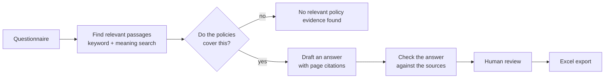

# TrustQuery

[](https://github.com/Harikiran0702/trustquery/actions/workflows/ci.yml)
[](LICENSE)

TrustQuery helps answer security questionnaires. You give it a list of questions, it looks through a company's security policies, and it drafts an answer for each one with the exact pages it used. If the policies don't cover a question, it says so instead of making something up. A person then reviews every answer before anything is exported.


**Live demo:** coming soon

## Why I built this

Companies selling software get long security questionnaires from their customers: "Do you encrypt data at rest?", "How quickly do you remove access when someone leaves?", and a hundred more like them. Answering them means digging through policy documents, and it's slow and repetitive.

An AI model can help, but only if you can trust the answers. A confident wrong answer on a security questionnaire is worse than no answer. So the main goal here was not "answer everything", it was "answer what the documents support, show where it came from, and be honest about the rest".

## How it works



1. **Search.** Each question is matched against the policy documents in two ways: keyword search (BM25) and meaning-based search (a small MiniLM embedding model). The two result lists are merged and re-ranked.
2. **Decide whether to answer.** If the best passages don't really match the question, for example it asks about a tool the policies never mention, TrustQuery doesn't answer.
3. **Draft.** With a Gemini API key, Gemini writes a short answer using only the retrieved passages and cites them. Without a key, TrustQuery shows the most relevant sentences from the policies instead.
4. **Check.** When the local fact-checking model is available, each answer is compared against its sources, and the result feeds into a confidence label.
5. **Review.** Everything lands in a review screen where a person can approve, edit, reject or mark it as needing more evidence. Only reviewed answers go into the Excel export.

Questions that ask whether something is *actually done* ("Do you enforce MFA today?") get flagged, because a policy saying something should happen isn't proof that it does.

## Results

I tested it on a set of 100 sample questions with known answers, and on 20 extra questions I wrote separately. I tuned the system on the 100, but never on the 20, so the 20 show how it handles questions it hasn't seen.

**Finding the right page (100-question set)**

| | Keyword only | Keyword + meaning (hybrid) |
|---|---|---|
| Correct page ranked first | 48% | 61% |
| Correct page in top 3 | 69% | 74% |
| Correct document in top 5 | 91% | 96% |

**Answer or not (20 unseen questions)**

| | Keyword only | Hybrid |
|---|---|---|
| Answered when it should (out of 12) | 11 | 11 |
| Declined when it should (out of 8) | 7 | 8 |

Full details are in [docs/EVALUATION.md](docs/EVALUATION.md).

## Run it yourself

You need Python 3.12.

```bash
python -m venv .venv
source .venv/bin/activate          # Windows: .venv\Scripts\activate
pip install -e ".[review,test]"

# Optional: download the two small search models (about 100 MB) for better results
python scripts/download_models.py

streamlit run src/trustquery/review_app.py
```

Then click **Load sample questionnaire**.

To get written answers from Gemini, copy `.env.example` to `.env` and add your `GEMINI_API_KEY`. Without it, the app still works and shows policy extracts.

To rerun the evaluation: `python scripts/evaluate.py --hybrid`

## Project layout

```
src/trustquery/
  pipeline.py        answers one question: search, decide, draft, check
  retrieval/         keyword search, meaning search, merging, re-ranking
  generation/        Gemini prompt and answer generation
  evaluation/        fact-checking and metrics
  ui/                the Streamlit review app
scripts/             evaluation, model download, demo cache
data/sample/         the eight sample policy documents
data/eval/           test questions and expected answers
tests/               about 1,350 automated tests
```

## Limitations

- The policies are fictional. They describe a made-up company called CloudDesk, so the answers say nothing about any real organisation.
- You can't upload your own policy documents yet; the app uses the eight bundled ones.
- English only.
- The "should I answer?" rules were tuned on a small set of questions and will need more testing on real questionnaires.

## License

MIT. See [LICENSE](LICENSE).
